# 🕵️ Digital Forensics Case Study — Data Exfiltration Investigation

**Author:** Shahad Alhrbi
**Field:** Digital Forensics & Incident Response (DFIR)
**Tools:** Autopsy · The Sleuth Kit · PowerShell · QuickStego · 7-Zip · HxD

---

## 📌 Overview

A hands-on forensic investigation of a suspected **intellectual-property theft** case. A forensic
image of a dismissed employee's laptop was examined to determine whether proprietary data was
stolen, how it was concealed, and whether the evidence was sufficient to support the claim.

> This write-up documents my end-to-end investigative process, from evidence validation to
> recovering hidden, encrypted and steganographically protected data.

---

## 🎯 Scenario

A semiconductor company protects a proprietary architecture (**MXC**) as a trade secret. An
employee was suspected of leaking it to a competitor. After surveillance showed files being copied
to a personal laptop via USB, the laptop was seized and imaged for analysis.

**My objective:** investigate the image, extract all relevant evidence, identify every concealment
technique, and conclude whether data theft occurred.

---

## 🔬 Investigation Walkthrough

### 1 · Evidence Integrity Verification
Before any analysis, I verified the image was an unaltered, bit-for-bit copy by comparing its
**MD5** and **SHA-1** hashes against the original acquisition log.

```powershell
Get-FileHash "data_theft.001" -Algorithm MD5
Get-FileHash "data_theft.001" -Algorithm SHA1
```

✅ Both hashes matched the acquisition log — the image is forensically sound.

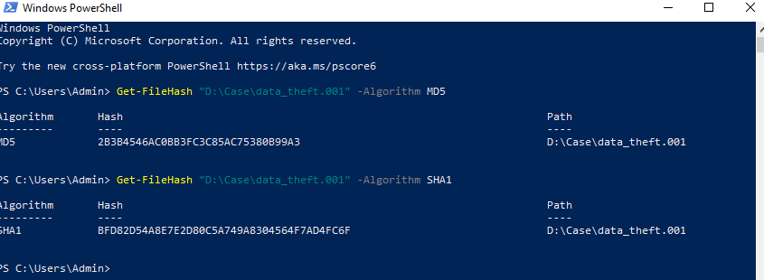

---

### 2 · Triage & Discovery in Autopsy
Running ingest modules surfaced key leads: **Encryption Detected**, **Extension Mismatch**, and
**E-Mail Messages**. I prioritized these over the thousands of benign system files.

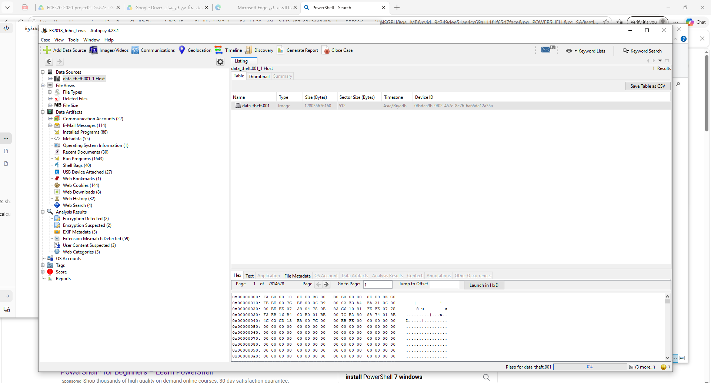

---

### 3 · Uncovering Disguised Files
Two files flagged by Autopsy had extensions that did not match their true content. Inspecting the
**file signatures (magic numbers)** and MIME types exposed them:

| File (as stored) | True type | What it really was |
|---|---|---|
| `tarantulla.jpg` | 7-Zip archive | Stolen source-code repository |
| `stuff_organizer.exe` | 7-Zip archive | A hidden document |
| `meofree.exe` | BMP image | Steganographic password carrier |
| `Mozart'sSymphony_no_187.wma` | Word document | Confidential board meeting minutes |

The header `37 7A BC AF 27 1C` is the 7-Zip signature — not a JPEG.

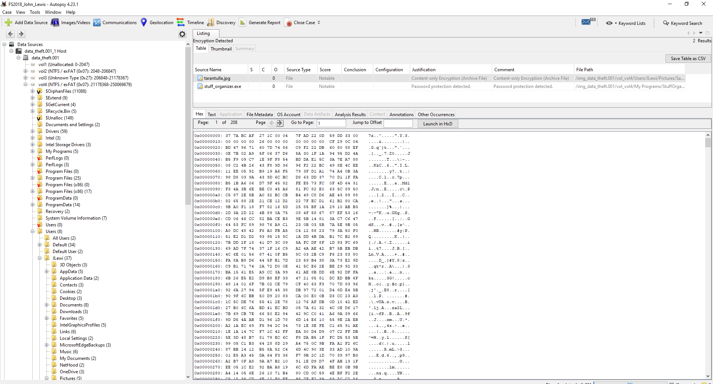
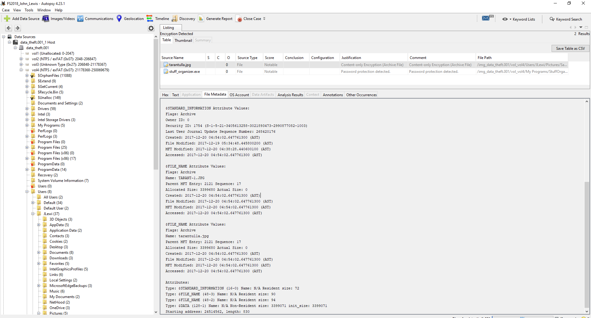

---

### 4 · Recovering the Hidden Password (Steganography)
The intercepted communication hinted the password could be "recovered using the usual procedure."
Since JPEG compression destroys embedded data, the carrier had to be uncompressed. The extension
mismatch list revealed a **BMP file disguised as `meofree.exe`**. Extracting its hidden text with
**QuickStego** revealed the password:

```
T@r@ntul@
```

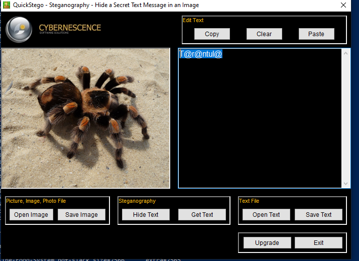

---

### 5 · Extracting the Stolen Intellectual Property
Using the recovered password, the first archive opened to reveal a complete **Git source-code
repository** of the company's proprietary mobile application.

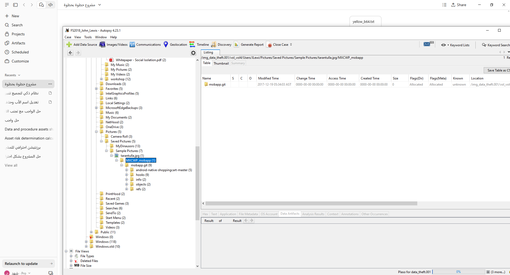
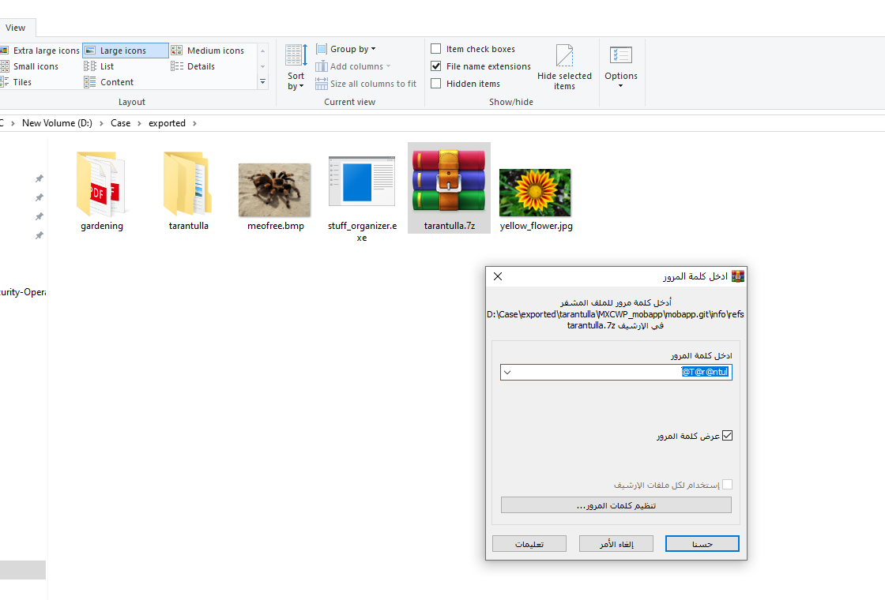
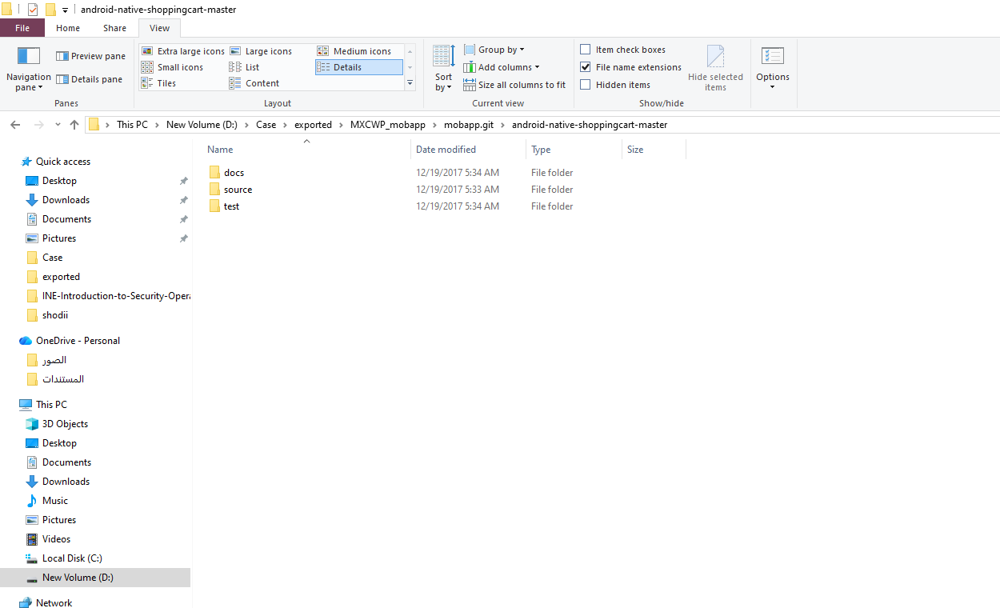

### 6 · Cracking the Nested Archive (three pass-codes)
The e-mail said "pass **codes**" — plural. There were in fact **three** passwords, and the second
archive was **nested**: a 7-Zip archive inside another, with a password ending in a **trailing
space** (an easy-to-miss anti-forensic trick).

| Password | Opens | Leads to |
|---|---|---|
| `T@r@ntul@` | tarantulla.jpg | MXC mobile-app source code |
| `L!terall!` + trailing space | stuff_organizer.exe | cooking.doc (a nested 7-Zip archive) |
| `Arm@ged0n` | cooking.doc (nested) | MXCWP_design-confidential.pdf |

The final payload was the **confidential MXC Design Outline** — the core algorithms and hardware
architecture of the stolen platform.

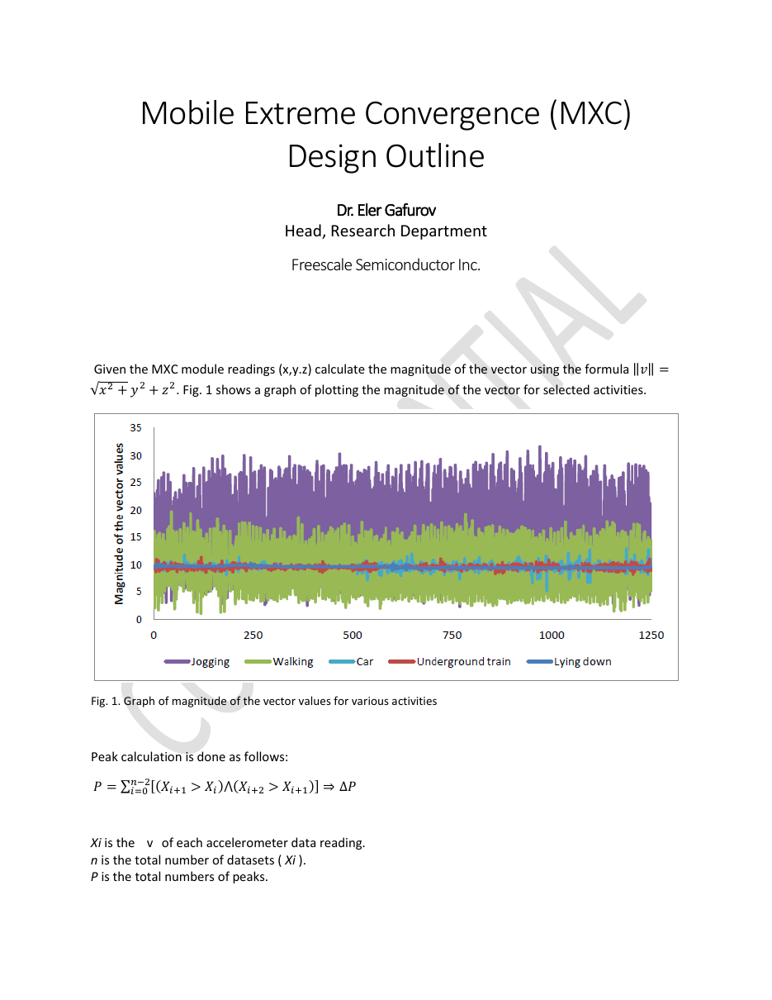

### 7 · The Board Minutes
A further item was disguised as an **audio file** (`.wma`) but was actually a Word document — the
company's **confidential board meeting minutes**. It required no password (extension change only),
and the document itself named the protected IP and the competitor as a theft risk.

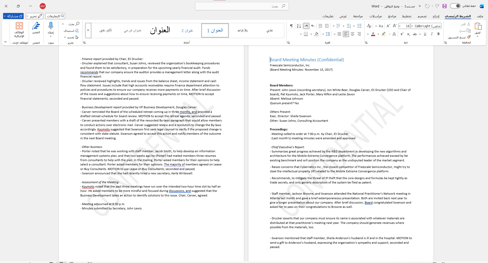

---

### 8 · Corroborating E-mail Evidence
Analysis of the mail store recovered a message to the competitor that **named the exact stolen
items** and requested **payment in bitcoin** — establishing intent and financial motive. Copies in
the *Deleted* folder indicated an attempt to erase the trail.

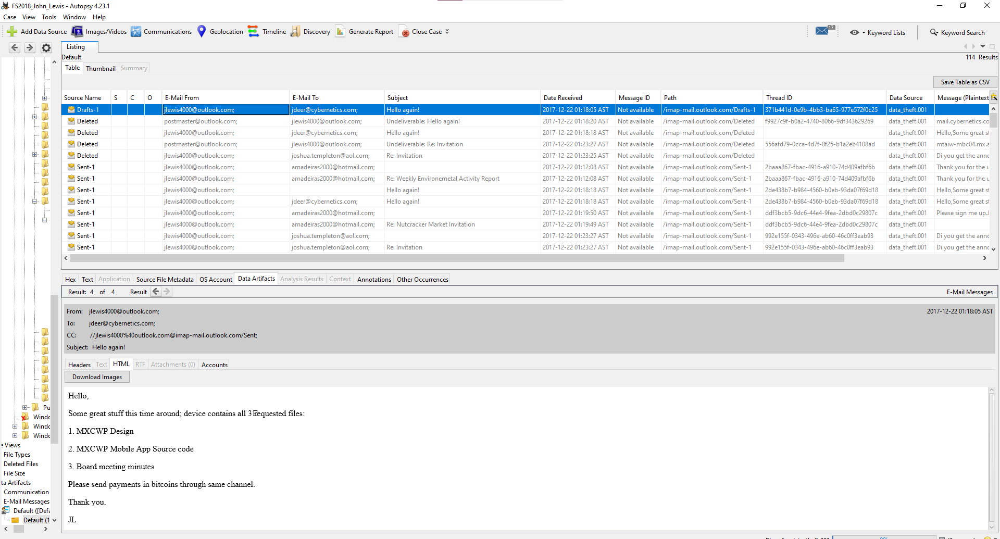

---

## 🧩 Concealment Techniques Identified

- **Extension spoofing** — archives/documents renamed to `.jpg` / `.exe` / `.wma`
- **Encryption** — password-protected 7-Zip archives (one with a trailing-space password)
- **Nested archives** — a 7-Zip archive hidden inside another, disguised with a `.doc` name
- **Steganography** — password hidden inside a BMP image
- **Folder camouflage** — files hidden among default Windows folders, a music folder, and fake "program" folders

---

## ✅ Conclusion

The combined evidence — recovered IP, layered concealment, a steganographically hidden password,
and an incriminating e-mail — provided strong, mutually corroborating proof of **attempted data
theft and unauthorized possession of trade secrets**.

Two points were documented transparently:
- One archived document was **corrupted within the image** and could not be fully recovered.
- The key exfiltration e-mail was **rejected by the recipient's mail server**, proving intent but
  not completed delivery.

---

## 🛠️ Skills Demonstrated

`Digital Forensics` · `Evidence Integrity / Hashing` · `Autopsy & Sleuth Kit` ·
`File Signature Analysis` · `Steganography Detection` · `Encrypted Archive Recovery` ·
`E-mail Forensics` · `Forensic Reporting`

---

*Investigation and report by **Shahad Alhrbi**.*
